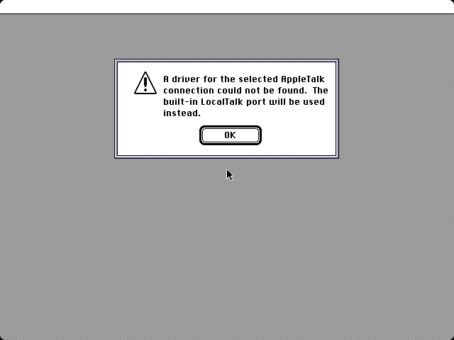

# System 7 floor test (`host/tools/s7floor/`)

Answers one question by measurement: **which is the oldest System 7 the daemon runs on over MacTCP?**
Measured 2026-11-22: **System 7.0** — the first System 7 — with MacTCP 2.0.6. 7.0 and 7.0.1 passed the ten-check
battery; the AppleBridgeInstaller preflight passes on 7.0.0 and its install comes up by itself after the restart.
Together with the Duo 230 (7.5, real hardware) that brackets 7.0–7.5; 7.1 was not tested. Below 7.0 there is
nothing to test: the daemon is built on Apple Events, FSSpec and the Process Manager, all new in 7.0, and the
installer refuses anything older.



*The installation on System 7.0 (Basilisk II on the C2, MacTCP 2.0.6), recorded with `record.py` and paced to
33 s: kit folder → installer preflight, every check OK on 7.0.0 → Install → Restart → the watchdog starts the
daemon → "installed and running" → bridge traffic from `battery.py` → About This Macintosh.*

## Pieces

| File | Runs on | Does |
|---|---|---|
| `build_disk.py` | this Mac | a bootable 7.0 / 7.0.1 disk from the Developer CD: System, Finder, a few control panels, MacTCP 2.0.6, and either the daemon in Startup Items or the AppleBridge Kit folder (`--kit`) |
| `c2/run_s7test.sh`, `c2/basilisk_ii_prefs` | the C2 (`~/s7test/`) | the `basilisk-s7test` container: own data, own PRAM, `ether slirp`, VNC on the docker bridge |
| `guest.sh` | this Mac | click / double-click / drag / keys in the guest via xdotool, and `shot` |
| `record.py` | this Mac | framebuffer frames via fb-export (no bridge needed); one, or a series for a clip |
| `battery.py` | this Mac | the ten checks through the bridge |
| `cliptest.py` | this Mac | clipboard round trips with **another** application in front |

## Procedure

1. **Inputs** (not in the repo): the Developer CDs `Dev.CD Jan 94.toast` and `Dev.CD Jan 96 SDK1.toast` in
   `$S7FLOOR_CDS` (default `~/Documents/Basilisk/CD Images`); in `$S7FLOOR_WORK` (default `~/.applebridge/s7floor`)
   `payload/AppleBridge.bin` (`mac_get_file … format=macbinary`), optionally `payload/MacTCP Prep.bin`, and for
   `--kit` the five `kit/<leaf>.bin`.
2. **Disk:** `uv run --with machfs python host/tools/s7floor/build_disk.py 70 s7_70.img`, then
   `scp s7_70.img pit@192.168.3.4:s7test/`.
3. **Hub side:** a host-server instance for the guest on 9050/9051 — no `guests.conf` row, so no watchdogs act
   on it:
   ```sh
   cd "$HOME/Library/Application Support/AppleBridge" && APPLEBRIDGE_CTRL_PORT=9051 APPLEBRIDGE_DAEMON_PORT=9050 \
     APPLEBRIDGE_GUEST_NAME=s7test APPLEBRIDGE_HOST_IP=192.168.3.232 APPLEBRIDGE_LOG=/tmp/applebridge_server_s7test.log \
     APPLEBRIDGE_REMOTE_GUEST=1 nohup ./run_server.sh >/dev/null 2>&1 &
   ```
4. **Boot:** `ssh pit@192.168.3.4 '~/s7test/run_s7test.sh s7_70.img'`. Every boot shows *"A driver for the selected
   AppleTalk connection could not be found"* (no EtherTalk on the disk): `guest.sh click 324 190`.
5. **MacTCP**, once, if there is no `MacTCP Prep.bin` yet: Control Panels → MacTCP → Ethernet → More… → Manually,
   gateway `10.0.2.2`, OK, IP `10.0.2.15`. Then fetch `…:System Folder:Preferences:MacTCP Prep` with `mac_get_file`
   into `payload/` — every later disk boots configured.
6. **Measure:** `uv run python host/tools/s7floor/battery.py 9051 s7_70 "S7 70" results --startup`, and
   `uv run python host/tools/s7floor/cliptest.py 9051 5 "host/tools/s7floor/guest.sh click 560 420"`.
7. **Stop** with `mac_shutdown` on 9051 (the container ends when the emulator powers off), never `docker rm -f`
   on a running guest.

## Gotchas measured on the way

- **Basilisk reads the pointer later than the button** — a press right after a move lands at the old position.
  `guest.sh` pauses after every move.
- **BasiliskII needs `NET_ADMIN` even on slirp**: the image's binary carries a file capability.
- **7.0's Disk Tools System is 6.0.7**, and 7.0's `Install 1:System` is incomplete without `Cerulean Data` —
  `build_disk.py` merges it.
- **Icons stack at (0,0)** when files are copied "inited" without their positions; `build_disk.py` clears the bit.
- **On System 7.0 the daemon cannot hand the front back.** `SetFrontProcess` back to the Finder never lands
  (also with repeated requests and a settled switch-in; 0.8d50 the same): CLIPSET/CLIPGET leave the daemon in
  front there. The text itself travels correctly (0.8d51). 7.5 hands it back (Duo, `b=1`).
- **The fb dump goes to the process by name** (`pkill -USR1 -x BasiliskII`); its PID is not stable.
